  

 

  &nbsp;
  &nbsp;
  &nbsp;
  

 

  

 

### Selected Work & Ventures

| Venture / Build | Space | What It Does |
| :--- | :--- | :--- |
| **[Kawn Labs](https://kawnlabs.com)** | Digital Studio | Co-founding & leading product engineering across bespoke web platforms, interactive 3D showcases, and business systems |
| **[The Choice](https://the-choice2.vercel.app)** · **[Hilal Arts](https://hilalarts.com)** | Commerce | Luxury & custom e-commerce storefronts featuring immersive product visualization, dynamic quoting, and Stripe flows |
| **[Najm Guides](https://najmguides.vercel.app)** · **[Sidrbooks](https://sidrbooks.com)** | Platforms | Guided spiritual travel experiences and multilingual publishing platforms built on Next.js, Sanity & Supabase |
| **Ledger & Operations Engines** | Business Ops | Internal receivables tracking, double-entry accounting dashboards, and workflow automations replacing manual spreadsheets |
| **Thaqib** *(BEng Research)* | Applied NLP | Morphological root-based indexing and semantic search engine designed for classical Arabic text corpora |
| **[Deen Scrolling](https://deenscrolling.com)** & Mobile | Product / Apps | Mindful daily habit platforms and cross-platform Flutter mobile experiences |

### Stack & Tooling

| Layer | Core Technologies |
| :--- | :--- |
| **Frontend & Motion** |       |
| **Backend & Commerce** |        |
| **Mobile & Intelligence** |      |
| **Design & Delivery** |    |

---

  Build thoughtfully. Ship intentionally. Keep improving. 
  <b>Sulaiman Sabry</b> (<a href="https://github.com/Spark014">@Spark014</a>) · Co-Founder at <a href="https://kawnlabs.com">Kawn Labs</a> · Colombo, Sri Lanka

