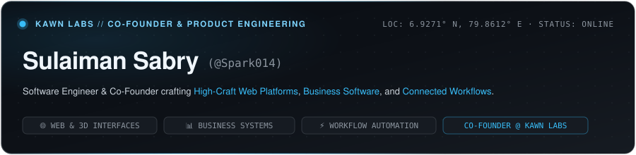
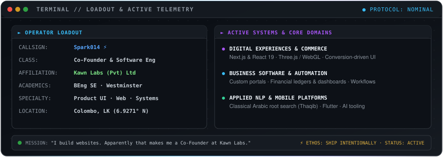

  

 

  

 

  
  
  
  

 

---

### 🎮 Tech Loadout & Capability Matrix

#### 🌐 High-Craft Web & Interactive Interfaces

#### 📊 Business Software, Commerce & Backend

#### 🧠 Applied AI, NLP & Cross-Platform Mobile

#### 🛠️ Product Architecture, Design & Delivery

---

### 🗺️ Active Quests & Systems

* **🚀 Kawn Labs — Digital Product & Client Architecture** — Co-founding and delivering high-craft web platforms, interactive 3D/WebGL showcases, luxury e-commerce storefronts (*The Choice*, *Hilal Arts*), and custom digital experiences (*Najm Guides*, *Sidrbooks*).
* **📊 Business Software & Financial Ledger Engines** — Engineering internal operations portals, receivables & accounting dashboards, dynamic quotation engines, and connected workflows that replace manual business friction.
* **🧠 Thaqib — Classical Arabic NLP Search Engine** — Final-year BEng Software Engineering R&D architecting a morphological root-based indexing and semantic retrieval engine for classical Arabic texts.
* **📱 Cross-Platform Mobile & Mindful Habit Systems** — Building native-feel Flutter and Next.js applications, from daily spiritual reflection platforms (*Deen Scrolling*) to gamified progression systems.

---

  <b>Spark014 ⚡</b> · Co-Founder & Product Engineering @ <a href="https://kawnlabs.com">Kawn Labs</a> · Final Year BEng (Hons) Software Engineering — University of Westminster

