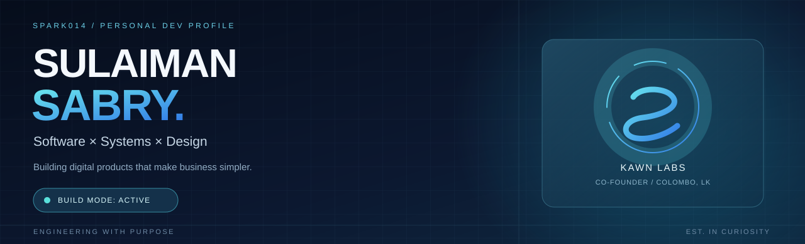
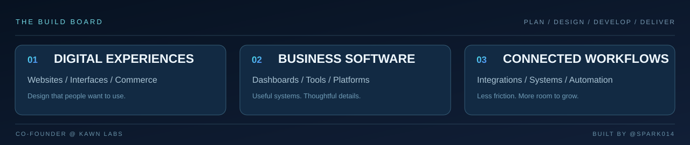

  

 

  

 

  
  
  

---

### The short version

> I build websites. Apparently that makes me a Co-Founder at Kawn Labs.

I'm **Sulaiman Sabry**, a software engineering student at the **University of Westminster** and a co-founder of **[Kawn Labs (Pvt) Ltd](https://kawnlabs.com)**, based in Colombo, Sri Lanka.

I'm interested in the space where **engineering, design and business** meet. I like turning ideas into polished digital products, creating tools people actually enjoy using, and finding ways to make complicated workflows simpler.

### What I build

| Digital experiences | Business software | Connected systems |
|:--|:--|:--|
| Websites, e-commerce and user-focused interfaces | Dashboards, internal tools and custom web applications | Integrations, process improvements and practical automations |

### Stack & tools

Tools used in my projects and learning journey — always building on the stack.

### Selected builds

| Project | What it explores |
|:--|:--|
| **[The Choice](https://github.com/Spark014/TheChoice2)** | A luxury e-commerce experience with a strong focus on design and interaction |
| **[Najm Guides](https://github.com/Spark014/najmguides)** | A digital experience for guided Umrah and travel journeys |
| **[VisuaLit](https://github.com/Spark014/visualit_web)** | A web interface for exploratory reading and discovery |
| **[Quote Calculator](https://github.com/Spark014/ratecalculator)** | A practical jewelry quotation calculator built with Next.js |
| **[YouLanka](https://github.com/Spark014/youlanka)** | Web work in the travel space |

### Currently focused on

- Building useful websites, business applications, and digital systems through **Kawn Labs**.
- Exploring how better interfaces and automation can reduce everyday business friction.
- Improving as a developer while strengthening the link between product thinking and implementation.

---

  <b>Have an idea worth building?</b> 
  <a href="https://kawnlabs.com">Kawn Labs</a> · <a href="https://www.linkedin.com/in/sulaiman-sabry-902w/">Connect on LinkedIn</a>
    
  Build thoughtfully. Ship intentionally. Keep improving. · @Spark014

